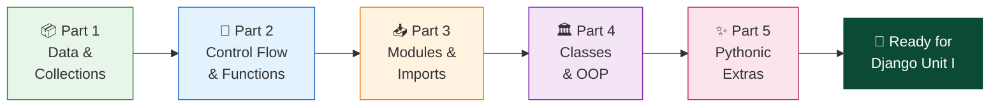
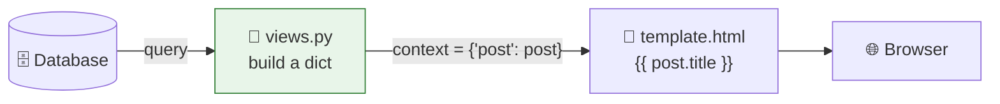
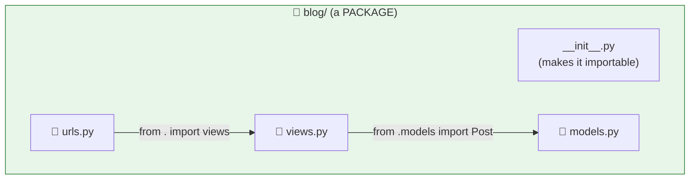
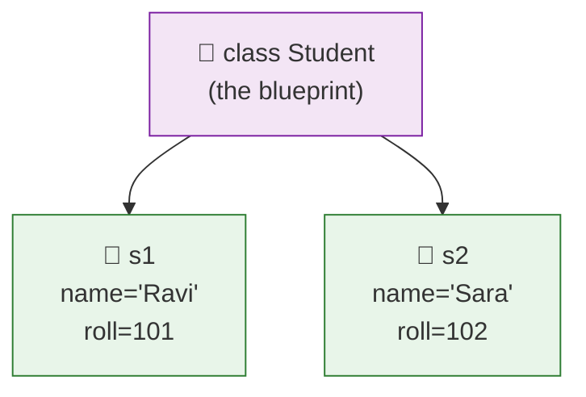
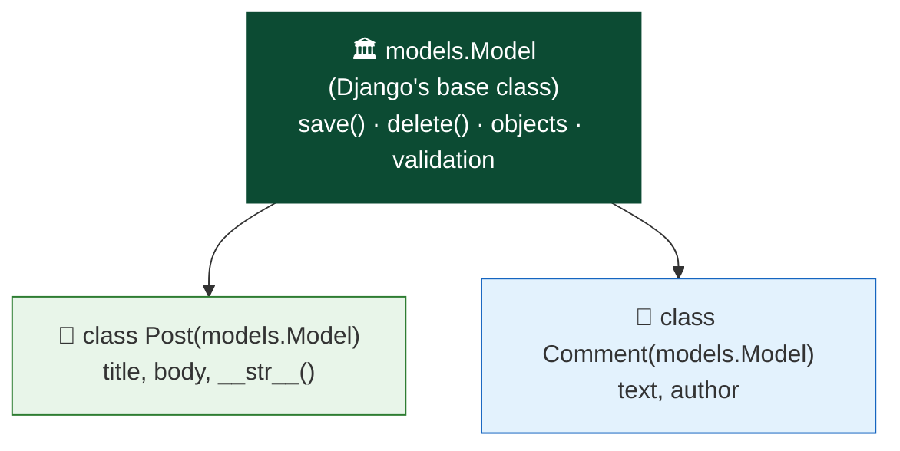
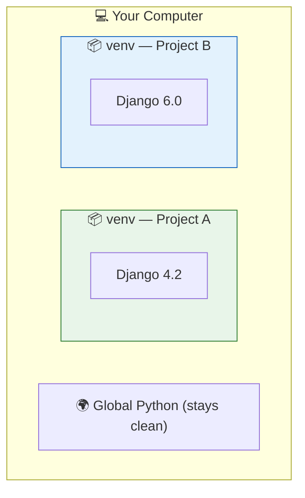

# 🐍 Python Essentials for Django

> **Course:** Full Stack Web Development (B.Tech, 4th Year)
> **Purpose:** Prerequisite refresher — every Python concept Django depends on
> **Read before:** Unit I — Introduction to Django

---

## 🎯 How to Use This Document

This is **not** a full Python course. It is the **20% of Python that Django uses 80% of the time**, and every section ends with the exact Django file where you'll meet that concept.



| Part | Concepts | Why Django Needs It |
|---|---|---|
| 1 | Variables, strings, lists, tuples, dicts, sets | `settings.py` is a Python file; template context is a dict |
| 2 | `if`/`for`, functions, `*args`/`**kwargs` | Every view is a function taking a request |
| 3 | Modules, packages, imports | Django is imports all the way down |
| 4 | Classes, `self`, inheritance, dunders | Every model subclasses `models.Model` |
| 5 | Decorators, comprehensions, exceptions, pathlib | `@login_required`, `BASE_DIR`, `DoesNotExist` |

---
---

# 📦 PART 1 — Data & Collections

## 1.1 Variables & Built-in Types

Python is **dynamically typed** — you never declare a type; Python infers it from the value.

```python
name    = "Django"      # str      — text
version = 6.0           # float    — decimal number
epochs  = 15            # int      — whole number
debug   = True          # bool     — True / False (capitalised!)
nothing = None          # NoneType — "no value"

print(type(version))    # <class 'float'>
```

### 🧠 The five types you'll use constantly

| Type | Example | Django Connection |
|---|---|---|
| `str` 📝 | `"blog"` | `CharField`, `TextField`, URLs, template names |
| `int` 🔢 | `42` | `IntegerField`, primary keys, pagination |
| `float` 📊 | `9.99` | `FloatField`, `DecimalField` (prices) |
| `bool` ✅ | `True` | `BooleanField`, `DEBUG`, `is_active` |
| `NoneType` ⭕ | `None` | Maps to SQL `NULL`; `null=True` on fields |

### ⚠️ Indentation IS Syntax

Python has **no braces `{}`**. A block is defined purely by indentation (4 spaces by convention).

```python
# ✅ correct
if debug:
    print("Debug mode")
    print("Still inside the if")
print("Outside the if")

# ❌ IndentationError
if debug:
print("This will crash")
```

> 💡 **Set your editor**: VS Code → Settings → search "Insert Spaces" → enable. Mixing tabs and spaces is the #1 beginner error.

### 🎯 Where you meet it in Django

```python
# mysite/settings.py — these are just Python variables!
DEBUG = True                                  # bool
ALLOWED_HOSTS = []                            # list
TIME_ZONE = 'Asia/Kolkata'                    # str
SECRET_KEY = 'django-insecure-abc123...'      # str
```

**`settings.py` is not a config format — it is executable Python.** That's why you can write logic in it:

```python
import os
DEBUG = os.environ.get('DEBUG', 'False') == 'True'    # perfectly valid!
```

---

## 1.2 Strings & f-strings

```python
title = "my first post"

title.upper()             # 'MY FIRST POST'
title.lower()             # 'my first post'
title.title()             # 'My First Post'
title.strip()             # removes leading/trailing whitespace
title.replace(" ", "-")   # 'my-first-post'
title.split()             # ['my', 'first', 'post']
title.startswith("my")    # True
len(title)                # 13
```

### ⚠️ Strings are IMMUTABLE

Every string method returns a **new** string. The original never changes.

```python
title = "hello"
title.upper()        # returns 'HELLO' — but title is STILL 'hello'!
print(title)         # 'hello'  😱

title = title.upper()  # ✅ you must ASSIGN the result
print(title)         # 'HELLO'
```

> 📝 **Exam question:** *"Are Python strings mutable? Justify."* → No. Methods return new objects; the original is unchanged.

### ✨ f-strings (Python 3.6+) — always use these

```python
name, count = "Ravi", 5

# ❌ old ways
"Hello, " + name + "! You have " + str(count) + " posts."
"Hello, {}! You have {} posts.".format(name, count)

# ✅ f-string — readable, fast, supports any expression
f"Hello, {name}! You have {count} posts."
f"Hello, {name.upper()}! Next year: {count + 1}"
f"Price: {9.99:.2f}"        # formatting: 'Price: 9.99'
```

### 🎯 Where you meet it in Django

```python
# models.py — __str__ returns a string
def __str__(self):
    return f"{self.title} by {self.author}"

# views.py — building messages
messages.success(request, f"Post '{post.title}' was created!")
```

Django templates use `{{ variable }}`, which is the **template-language cousin** of the f-string:

```python
# Python:   f"Hello {name}"
# Template: Hello {{ name }}
```

---

## 1.3 Lists — Ordered & Mutable

```python
apps = ['blog', 'shop']

# --- adding ---
apps.append('users')          # ['blog', 'shop', 'users']  → add to end
apps.insert(0, 'core')        # ['core', 'blog', 'shop', 'users']
apps.extend(['api', 'auth'])  # adds multiple

# --- accessing ---
apps[0]      # 'core'      → first
apps[-1]     # 'auth'      → LAST (negative counts backwards)
apps[1:3]    # ['blog','shop']  → slice [start:stop) — stop is EXCLUDED

# --- removing ---
apps.remove('shop')    # remove by VALUE
apps.pop()             # remove & return LAST item
del apps[0]            # remove by INDEX

# --- info ---
len(apps)              # how many
'blog' in apps         # True/False — membership test
apps.sort()            # sorts IN PLACE (returns None!)
sorted(apps)           # returns a NEW sorted list
```

### 📐 Slicing visualised

```
     apps = [ 'core' , 'blog' , 'shop' , 'users' ]
index:          0        1        2        3
neg. index:    -4       -3       -2       -1

apps[1:3]  →  ['blog', 'shop']      # index 1 up to (not including) 3
apps[:2]   →  ['core', 'blog']      # from start
apps[2:]   →  ['shop', 'users']     # to end
apps[::-1] →  reversed list
```

---

## 1.4 Tuples — Ordered & Immutable

```python
point = (10, 20)
point[0]        # 10   ✅ reading works
point[0] = 99   # ❌ TypeError: 'tuple' object does not support item assignment

# unpacking — very Pythonic
x, y = point    # x = 10, y = 20
```

### 🆚 List vs Tuple — when to use which

| | 📋 List `[]` | 🔒 Tuple `()` |
|---|---|---|
| **Mutable?** | ✅ Yes — can change | ❌ No — fixed forever |
| **Use when** | Contents will change | Contents must never change |
| **Speed** | Slightly slower | Slightly faster |
| **Django example** | `INSTALLED_APPS`, `urlpatterns` | `choices` pairs |

### 🎯 Where you meet it in Django

```python
# settings.py — a LIST (you add to it)
INSTALLED_APPS = [
    'django.contrib.admin',
    'blog',              # ← you edit this list
]

# models.py — a LIST of TUPLES (each pair is fixed)
STATUS_CHOICES = [
    ('d', 'Draft'),          # (value stored in DB, label shown to user)
    ('p', 'Published'),
]
status = models.CharField(max_length=1, choices=STATUS_CHOICES)
```

> 💬 **Why tuples for choices?** Each pair `('d', 'Draft')` is a fixed mapping — it must never be accidentally modified at runtime. The immutability is a safety feature.

---

## 1.5 Dictionaries — The Most Important Type 👑

A dictionary stores **key → value** pairs. If you master one collection type, make it this one.

```python
post = {'title': 'Hello', 'views': 42}

# --- reading ---
post['title']            # 'Hello'
post['missing']          # ❌ KeyError — crashes!
post.get('missing')      # ✅ None — safe
post.get('missing', 0)   # ✅ 0 — with a default

# --- writing ---
post['author'] = 'Ravi'  # add a new key
post['views'] = 43       # update existing
del post['views']        # remove a key

# --- inspecting ---
post.keys()              # dict_keys(['title', 'author'])
post.values()            # dict_values(['Hello', 'Ravi'])
post.items()             # pairs — use this for looping
'title' in post          # True — checks KEYS

# --- looping (memorise this pattern) ---
for key, value in post.items():
    print(f"{key} = {value}")
```

### 🪆 Nested dictionaries

Dictionaries can contain dictionaries — which is exactly how Django's config works:

```python
DATABASES = {
    'default': {                                   # dict inside a dict
        'ENGINE': 'django.db.backends.sqlite3',
        'NAME': BASE_DIR / 'db.sqlite3',
    }
}

DATABASES['default']['ENGINE']    # drill down with repeated []
```

### 🎯 Where you meet it in Django — the big one



```python
# views.py
def home(request):
    posts = Post.objects.all()
    context = {'posts': posts, 'page_title': 'Home'}   # ← A DICTIONARY
    return render(request, 'home.html', context)
```

```html
<!-- home.html — reads that same dictionary -->
<h1>{{ page_title }}</h1>

  <li>{{ post.title }}</li>

```

> 🔑 **The core insight:** A Django view's job is usually *fetch data → build a dictionary → hand it to a template*. If dictionaries feel shaky, views will feel like magic instead of code.

---

## 1.6 Sets (Bonus) — Unique, Unordered

```python
tags = {'python', 'django', 'python'}    # {'python', 'django'} — duplicates removed
tags.add('web')
'django' in tags                          # True — very fast lookup

{1,2,3} & {2,3,4}    # {2, 3}     intersection
{1,2,3} | {2,3,4}    # {1,2,3,4}  union
{1,2,3} - {2}        # {1, 3}     difference
```

Used in Django for deduplicating tags, comparing permission sets, and fast membership checks.

---

## ✅ CHECKPOINT — Part 1

**🧠 Recap**
- Python infers types; indentation defines blocks
- Strings are **immutable** — methods return new strings; f-strings for formatting
- **List** = mutable ordered; **Tuple** = immutable ordered; **Dict** = key→value; **Set** = unique
- `settings.py` is executable Python, not a config file

**❓ Quiz**
1. What does `post.get('x')` return if `'x'` isn't a key? What does `post['x']` do?
2. Is `title.upper()` enough to change `title`? Why not?
3. Give one Django example each of a list and a tuple.
4. What Python type is a Django template context?

**✍️ Practice**
```python
# Build this dict, then print each pair on its own line using .items()
student = {'name': 'Aman', 'roll': 101, 'section': 'K21'}
# Then: safely read a key 'email' that doesn't exist, defaulting to 'not set'
```

---
---

# 🔀 PART 2 — Control Flow & Functions

## 2.1 Conditionals — `if` / `elif` / `else`

```python
views = 150

if views > 100:
    label = "Popular"
elif views > 10:
    label = "Rising"
else:
    label = "New"
```

### Comparison & logical operators

| Operator | Meaning | Example |
|---|---|---|
| `==` `!=` | equal / not equal | `status == 'p'` |
| `>` `<` `>=` `<=` | comparisons | `views >= 100` |
| `and` `or` `not` | logic (words, not `&&`/`\|\|`) | `if user and not user.is_staff:` |
| `in` | membership | `if 'blog' in INSTALLED_APPS:` |
| `is` / `is None` | identity | `if value is None:` |

> ⚠️ Use `==` to compare **values**, `is` to compare **identity**. For `None`, always write `if x is None`.

### 🫥 Truthiness — empty things are False

```python
if posts:        # True if the list has items, False if empty
    ...
```

| Falsy 🔴 | Truthy 🟢 |
|---|---|
| `False`, `None`, `0`, `0.0` | any non-zero number |
| `""` (empty string) | any non-empty string |
| `[]`, `{}`, `()`, `set()` | any non-empty collection |

---

## 2.2 Loops

```python
# for — iterate over a collection
for post in posts:
    print(post.title)

# with an index
for i, post in enumerate(posts, start=1):
    print(f"{i}. {post.title}")

# a fixed number of times
for i in range(5):        # 0,1,2,3,4
    print(i)

# looping a dict
for key, value in context.items():
    print(key, value)

# while — until a condition changes
attempts = 0
while attempts < 3:
    attempts += 1

# control
for p in posts:
    if p.draft:
        continue      # skip this one, go to next
    if p.id == 99:
        break         # exit the loop entirely
```

### 🔁 Python vs Django Template — the same logic twice

```python
# PYTHON (views.py)                    # TEMPLATE (.html)
if post.views > 100:                   
    label = 'Popular'                    <b>Popular</b>
else:                                  
    label = 'New'                        <b>New</b>
                                       

for post in posts:                     
    print(post.title)                    <li>{{ post.title }}</li>
                                       
```

> 💡 **Why templates need ``:** HTML has no indentation rule, so the template language must mark where a block ends explicitly. Learn the Python form and the template form is 10 minutes of extra work.

---

## 2.3 Functions

```python
def greet(name, greeting="Hello"):
    """Return a greeting. (This is a docstring.)"""
    return f"{greeting}, {name}!"
```

Anatomy:

| Part | In the example |
|---|---|
| `def` keyword | `def` |
| Function name | `greet` |
| Parameters | `name` (required), `greeting` (has a **default**) |
| Docstring | `"""Return a greeting."""` |
| Return value | the f-string (a function with no `return` gives `None`) |

### 📞 Four ways to call it

```python
greet("Ravi")                        # 'Hello, Ravi!'        positional
greet("Ravi", "Namaste")             # 'Namaste, Ravi!'      positional
greet(name="Ravi")                   # 'Hello, Ravi!'        keyword
greet(greeting="Hi", name="Sara")    # 'Hi, Sara!'           keyword, any order
```

> ⚠️ **Default parameters must come last.** `def f(a=1, b)` is a `SyntaxError`.

### ⭐ `*args` and `**kwargs`

```python
def show(*args, **kwargs):
    print(args)      # a TUPLE of extra positional arguments
    print(kwargs)    # a DICT of extra keyword arguments

show(1, 2, name="Ravi", city="Jalandhar")
# (1, 2)
# {'name': 'Ravi', 'city': 'Jalandhar'}
```

You'll see these constantly in Django source and when overriding methods:

```python
def save(self, *args, **kwargs):
    self.slug = slugify(self.title)
    super().save(*args, **kwargs)     # pass everything through unchanged
```

### 🌍 Scope

```python
counter = 0            # global

def increment():
    counter = 5        # creates a NEW LOCAL variable — global unchanged!
    return counter

increment()            # 5
print(counter)         # 0  ← surprised? that's scope
```

### 🎯 Where you meet it in Django — **a view IS a function**

```python
# blog/views.py
from django.shortcuts import render

def home(request):                       # ← takes a request
    posts = Post.objects.all()
    return render(request, 'home.html', {'posts': posts})   # ← returns a response
```

> 🔑 **The single most useful sentence in this document:** *A Django view is just a Python function that receives a request object and returns a response object.* Nothing more.

---

## ✅ CHECKPOINT — Part 2

**🧠 Recap**
- `if`/`elif`/`else`; `and`/`or`/`not` are words; empty collections are falsy
- `for` iterates collections; `enumerate()` gives an index; `range()` counts
- Functions: `def`, parameters with defaults, `return`; `*args`/`**kwargs` collect extras
- Templates mirror Python's `if`/`for` but need explicit end tags

**❓ Quiz**
1. What does a function return if it has no `return` statement?
2. Why does `if posts:` work for checking an empty list?
3. In `def f(*args, **kwargs)`, what type is `args`? What type is `kwargs`?
4. Write the Django-template equivalent of a Python `for` loop.

**✍️ Practice**
```python
# Write grade(marks) that returns 'A' for >=90, 'B' for >=75, 'C' for >=60, else 'F'.
# Then loop over [95, 80, 65, 40] printing "Marks 95 -> A" for each.
```

---
---

# 📥 PART 3 — Modules, Packages & Imports

## 3.1 The Three Import Forms

```python
# 1️⃣ import the whole module — access with dot notation
import math
math.sqrt(16)          # 4.0

# 2️⃣ import specific names — most common in Django
from math import sqrt, pi
sqrt(16)               # 4.0  (no prefix needed)

# 3️⃣ import with an alias
import pandas as pd
from django.contrib.auth.models import User as AuthUser
```

> ❌ **Never use `from math import *`** — it dumps every name into your namespace and makes it impossible to tell where something came from.

## 3.2 Modules vs Packages

| | 📄 Module | 📁 Package |
|---|---|---|
| **What** | A single `.py` file | A folder of modules |
| **Requires** | nothing | an `__init__.py` file |
| **Example** | `views.py` | the `blog/` app folder |



### 🏷️ What `__init__.py` actually does

An **empty file** whose mere presence tells Python "this folder is a package — you may import from it." Delete it and `from blog.models import Post` breaks.

## 3.3 Relative Imports — the `.` notation

```python
from . import views              # '.'  = THIS package (same folder)
from .models import Post         # a module in this folder
from ..core import utils         # '..' = parent package
```

## 3.4 🎯 Where you meet it in Django — everywhere

| File | Typical imports |
|---|---|
| `mysite/urls.py` | `from django.urls import path, include` |
| `blog/urls.py` | `from . import views` |
| `blog/views.py` | `from .models import Post` · `from django.shortcuts import render` |
| `blog/models.py` | `from django.db import models` |
| `blog/admin.py` | `from django.contrib import admin` · `from .models import Post` |
| `settings.py` | `from pathlib import Path` |

> 💬 **A useful way to see Django:** it is a large collection of small modules you import from. Learning Django is largely learning *what to import from where*.

---

## ✅ CHECKPOINT — Part 3

**🧠 Recap**
- Three forms: `import x`, `from x import y`, `import x as z`
- Module = one file; Package = folder + `__init__.py`
- `.` = current package, `..` = parent
- Every Django file opens with imports

**❓ Quiz**
1. What breaks if you delete `__init__.py` from an app folder?
2. Difference between `import math` and `from math import sqrt` at the call site?
3. What does the `.` mean in `from . import views`?

---
---

# 🏛️ PART 4 — Classes & Object-Oriented Python

This is the part that makes Django's models and class-based views make sense. Spend the most time here.

## 4.1 Classes & Objects

A **class** is a blueprint 📐; an **object** is one real thing built from it 🏠.

```python
class Student:
    college = "LPU"                     # CLASS attribute — shared by all

    def __init__(self, name, roll):     # constructor — runs automatically
        self.name = name                # INSTANCE attributes — per object
        self.roll = roll

    def greet(self):                    # a METHOD
        return f"Hi, {self.name} from {self.college}"

# create objects (instances)
s1 = Student("Ravi", 101)
s2 = Student("Sara", 102)

s1.name        # 'Ravi'
s2.name        # 'Sara'    ← independent!
s1.greet()     # 'Hi, Ravi from LPU'
```



### 🤔 What is `self`?

`self` means **"this particular object"**. When you call `s1.greet()`, Python secretly passes `s1` as `self`.

```python
s1.greet()            # what you write
Student.greet(s1)     # what Python actually does
```

**Rules:**
1. `self` must be the **first parameter** of every instance method
2. You **never pass it** when calling
3. Use `self.x` to store/read data on that object

> ⚠️ **The classic error:** forgetting `self` gives
> `TypeError: greet() takes 0 positional arguments but 1 was given`
> — because Python passed the object but your method didn't accept it.

### Class vs Instance attributes

```python
Student.college        # 'LPU'   — belongs to the class
s1.college             # 'LPU'   — inherited from the class
s1.name                # 'Ravi'  — belongs to THIS object only
```

---

## 4.2 Inheritance — The Heart of Django

A class can **inherit** everything from another class, then add or override behaviour.

```python
class Animal:
    def __init__(self, name):
        self.name = name

    def speak(self):
        return "..."

    def describe(self):
        return f"{self.name} says {self.speak()}"


class Dog(Animal):              # ← Dog INHERITS from Animal
    def speak(self):            # ← OVERRIDES the parent method
        return "Woof"


d = Dog("Tommy")
d.speak()       # 'Woof'                    (overridden)
d.describe()    # 'Tommy says Woof'         (inherited, uses the override!)
d.name          # 'Tommy'                   (inherited __init__)
```

### `super()` — calling the parent's version

```python
class Puppy(Dog):
    def speak(self):
        original = super().speak()      # calls Dog.speak()
        return f"{original} (softly)"
```

### 🎯 Where you meet it in Django — **this is the payoff**

```python
# blog/models.py
from django.db import models

class Post(models.Model):                          # ← inherit from Model
    title = models.CharField(max_length=100)
    body  = models.TextField()

    def __str__(self):
        return self.title
```

You wrote **4 lines**. By inheriting from `models.Model`, `Post` automatically gets:

| Inherited for free 🎁 | What it does |
|---|---|
| `.save()` | write this object to the database |
| `.delete()` | remove the row |
| `.objects` | the query manager — `Post.objects.all()`, `.filter()`, `.get()` |
| Field validation | type checks, max lengths, required fields |
| Migration support | `makemigrations` can see your fields |
| Admin integration | one line in `admin.py` and it's manageable |

> 🔑 **Understanding inheritance IS understanding Django.** Models, forms, class-based views, custom user models — all of it is "subclass a Django base class, override what you need."



---

## 4.3 Dunder Methods — Especially `__str__`

**Dunder** = "double underscore". These are methods Python calls automatically.

| Dunder | Triggered by | Purpose |
|---|---|---|
| `__init__` | `Post("Hi")` | object creation |
| `__str__` | `print(obj)`, `str(obj)` | human-readable text |
| `__len__` | `len(obj)` | length |
| `__eq__` | `a == b` | equality comparison |
| `__repr__` | typing `obj` in the shell | developer-facing text |

### Why `__str__` matters so much in Django

```python
# ❌ WITHOUT __str__
class Post(models.Model):
    title = models.CharField(max_length=100)

# Admin panel shows:
#   Post object (1)
#   Post object (2)
#   Post object (3)      ← useless!


# ✅ WITH __str__
class Post(models.Model):
    title = models.CharField(max_length=100)

    def __str__(self):
        return self.title

# Admin panel shows:
#   My First Post
#   Django Is Fun
#   Weekend Update       ← readable!
```

> 📌 **Rule for this entire course:** define `__str__` on **every** model you write. It's one method and it transforms the admin experience.

---

## ✅ CHECKPOINT — Part 4

**🧠 Recap**
- Class = blueprint, object = instance built from it
- `__init__` runs automatically on creation; `self` = "this object"
- Inheritance: `class Child(Parent)` gets everything, can override; `super()` calls the parent
- `models.Model` gives your class database powers for free
- Always define `__str__`

**❓ Quiz**
1. Explain `self` without using the word "self".
2. What error do you get if you write `def greet():` instead of `def greet(self):`?
3. Name three things `Post` inherits from `models.Model`.
4. What does the admin show for a model with no `__str__`?

**✍️ Practice**
```python
# 1. Write class Book with __init__(title, author, pages) and a __str__.
# 2. Write class EBook(Book) that adds file_size and overrides __str__
#    to include it. Use super().__init__(...).
```

---
---

# ✨ PART 5 — Pythonic Extras Django Leans On

## 5.1 Decorators

A **decorator** adds behaviour *around* a function without editing the function itself.

```python
def check_login(func):              # takes a function
    def wrapper(user):              # defines a replacement
        if not user.is_authenticated:
            return "Please log in"
        return func(user)           # call the original
    return wrapper                  # return the replacement


@check_login                        # ← apply it
def dashboard(user):
    return "Secret data"
```

The `@` is **syntactic sugar**. These two are identical:

```python
@check_login
def dashboard(user): ...

# is exactly the same as:
def dashboard(user): ...
dashboard = check_login(dashboard)
```

### 🎯 Django decorators you'll actually use

```python
from django.contrib.auth.decorators import login_required

@login_required                      # 🔒 redirect anonymous users to login
def dashboard(request):
    return render(request, 'dash.html')

@admin.register(Post)                # 🎛️ register a model in the admin
class PostAdmin(admin.ModelAdmin): ...

@property                            # 🏷️ use a method like an attribute
def full_name(self):
    return f"{self.first} {self.last}"
# then:  person.full_name   (no parentheses!)

@csrf_exempt                         # ⚠️ skip CSRF check (use rarely!)
@receiver(post_save, sender=Post)    # 📡 signals
```

> 💡 **You will USE many decorators and rarely WRITE one.** What matters is recognising the `@` syntax and knowing it's just a function wrapping another function.

---

## 5.2 List Comprehensions

A loop that builds a list, written in one line.

```python
# long way
titles = []
for p in posts:
    titles.append(p.title)

# Pythonic way
titles = [p.title for p in posts]
```

**Pattern:** `[expression for item in iterable if condition]`

```python
[p.title for p in posts if p.published]        # with a filter
[n * n for n in range(5)]                      # [0, 1, 4, 9, 16]
{p.id: p.title for p in posts}                 # DICT comprehension
{p.category for p in posts}                    # SET comprehension (unique)
```

> ⚠️ **Don't overdo it.** If a comprehension needs more than one `if` or a nested loop, write a normal `for` loop — readability beats cleverness.

---

## 5.3 Exception Handling

```python
try:
    post = Post.objects.get(id=99)
except Post.DoesNotExist:                # catch a SPECIFIC exception
    post = None
except Exception as e:                   # catch-all (use sparingly)
    print(f"Something failed: {e}")
else:
    print("Ran only if NO exception")
finally:
    print("Always runs — cleanup goes here")
```

### Common exceptions you'll meet

| Exception | Cause |
|---|---|
| `KeyError` | dict key doesn't exist → use `.get()` |
| `IndexError` | list index out of range |
| `TypeError` | wrong type (e.g. `"3" + 3`) |
| `ValueError` | right type, bad value (`int("abc")`) |
| `AttributeError` | object has no such attribute |
| `ImportError` / `ModuleNotFoundError` | bad import or venv not active |
| `Post.DoesNotExist` | Django: `.get()` found nothing |

### 🎯 Django's shortcut

```python
# instead of this...
try:
    post = Post.objects.get(id=pk)
except Post.DoesNotExist:
    raise Http404

# ...Django gives you:
from django.shortcuts import get_object_or_404
post = get_object_or_404(Post, id=pk)
```

> 💬 Django is full of shortcuts like this — but you must know the underlying Python to recognise what they're saving you.

---

## 5.4 pathlib — Modern Path Handling

```python
from pathlib import Path

BASE_DIR = Path(__file__).resolve().parent.parent
db_path  = BASE_DIR / 'db.sqlite3'          # '/' JOINS paths!
```

| Piece | Meaning |
|---|---|
| `__file__` | path of the current `.py` file |
| `.resolve()` | make it absolute |
| `.parent` | go up one folder |
| `/` | join paths — works on Windows *and* Linux |

> ✅ **Why not string concatenation?** `"folder" + "/" + "file"` breaks on Windows (backslashes). `pathlib` handles OS differences for you. This exact line is at the top of every Django `settings.py`.

---

## 5.5 Virtual Environments & pip

```bash
python -m venv venv              # 1️⃣ create an isolated box
venv\Scripts\activate            # 2️⃣ activate — Windows
source venv/bin/activate         #    activate — Mac/Linux
pip install django               # 3️⃣ install INSIDE the box
pip freeze > requirements.txt    # 4️⃣ record exact versions
pip install -r requirements.txt  #    a teammate reproduces it
deactivate                       # 5️⃣ leave
```



> 🛠️ **`ModuleNotFoundError: No module named 'django'`** → 90% of the time your venv simply isn't activated. Look for `(venv)` at the start of your terminal prompt.

---

## ✅ CHECKPOINT — Part 5

**🧠 Recap**
- Decorator = function wrapping a function; `@` is sugar for `f = deco(f)`
- Comprehension = `[expr for item in iterable if cond]`
- `try/except/else/finally`; catch **specific** exceptions
- `pathlib` joins paths with `/`; `BASE_DIR` uses it
- One venv per project; activate before every Django command

**❓ Quiz**
1. Rewrite `@login_required` above `def view(request)` without using `@`.
2. Convert to a comprehension: a loop collecting `p.title` for published posts.
3. Which exception does `Post.objects.get()` raise when nothing matches?
4. Why does `settings.py` use `pathlib` instead of string concatenation?

---
---

# 🗺️ THE MAP — Every Concept → Where Django Uses It

| Python Concept | Where It Shows Up in Django |
|---|---|
| Variables & types | `settings.py`: `DEBUG`, `TIME_ZONE`, `SECRET_KEY` |
| Strings / f-strings | `__str__()`, slugs, messages, query building |
| Lists | `INSTALLED_APPS`, `urlpatterns`, `MIDDLEWARE` |
| Tuples | `choices` pairs, fixed mappings |
| **Dictionaries** | **template context**, `DATABASES`, `request.POST` |
| Sets | deduplicating tags, permission comparisons |
| `if` / `for` | view logic — mirrored by `` / `` |
| **Functions** | **function-based views: request in, response out** |
| `*args` / `**kwargs` | overriding `save()`, `get_context_data()` |
| Imports & packages | every file's first lines · `__init__.py` in each app |
| Classes & `self` | models, forms, class-based views |
| **Inheritance** | **`class Post(models.Model)` — the core of Django** |
| `__str__` | readable object names in the admin panel |
| Decorators | `@login_required`, `@property`, `@admin.register` |
| Comprehensions | building context lists compactly |
| `try` / `except` | `Post.DoesNotExist` → `get_object_or_404` |
| `pathlib` | `BASE_DIR` in `settings.py` |
| venv / pip | project isolation, `requirements.txt` |

---

# 🎓 FINAL SELF-CHECK

Tick each one honestly. Any gaps → revisit that section before Unit I.

- [ ] Build a dictionary and safely read a missing key with `.get()`
- [ ] Write a function with a default parameter and call it three different ways
- [ ] Explain what `self` is **without using the word "self"**
- [ ] Write a class that inherits from another and overrides one method
- [ ] Say what `__str__` does and why every Django model needs it
- [ ] Read `@login_required` and explain what the `@` means
- [ ] Explain the difference between a list and a tuple with a Django example
- [ ] Create a virtual environment, activate it, and install Django inside it
- [ ] Trace: view builds a dict → template reads it → browser shows HTML

---

# 🧪 CONSOLIDATION EXERCISE

Write this in a single `.py` file. It uses **every** concept in this document.

```python
"""Mini blog system — pure Python, no Django yet."""
from pathlib import Path                                   # Part 5


class Content:                                             # Part 4: class
    """Base class for anything publishable."""

    site = "LPU Blog"                                      # class attribute

    def __init__(self, title, author):                     # __init__ + self
        self.title = title
        self.author = author
        self.published = False

    def publish(self):                                     # method
        self.published = True
        return f"'{self.title}' is live!"                  # Part 1: f-string

    def __str__(self):                                     # Part 4: dunder
        status = "✅" if self.published else "📝"          # Part 2: inline if
        return f"{status} {self.title} — {self.author}"


class Post(Content):                                       # Part 4: inheritance
    def __init__(self, title, author, tags=None):          # Part 2: default arg
        super().__init__(title, author)                    # call the parent
        self.tags = tags or []                             # Part 1: list

    def __str__(self):
        base = super().__str__()
        return f"{base} [{', '.join(self.tags)}]"


def summarise(posts):                                      # Part 2: function
    """Return a dict of blog statistics."""
    published = [p for p in posts if p.published]          # Part 5: comprehension
    return {                                               # Part 1: dict
        'total': len(posts),
        'published': len(published),
        'titles': [p.title for p in published],
        'authors': {p.author for p in posts},              # Part 1: set
    }


# ---- run it ----
posts = [
    Post("Django Basics", "Ravi", ["django", "python"]),
    Post("Why Python?", "Sara"),
    Post("Deploying Apps", "Ravi", ["devops"]),
]

posts[0].publish()
posts[2].publish()

for i, p in enumerate(posts, start=1):                     # Part 2: enumerate
    print(f"{i}. {p}")

stats = summarise(posts)
for key, value in stats.items():                           # Part 1: .items()
    print(f"{key:12} → {value}")

try:                                                       # Part 5: exceptions
    print(posts[99])
except IndexError:
    print("No such post — handled safely.")

print("Base dir:", Path(__file__).resolve().parent)        # Part 5: pathlib
```

**Now map it:** every commented concept above will reappear in Django as a model, a view, or a setting. When you meet `class Post(models.Model)` next week, you'll recognise it as exactly the `Post(Content)` pattern you just wrote.

---

> 🚀 **Next:** Unit I — Introduction to Django (installation, MVT, projects & apps, first view)
