# 🐍 Unit I — Introduction to Django

> **Course:** Full Stack Web Development (B.Tech, 4th Year)
> **Duration:** 5 Lectures × 50 minutes
> **Prerequisite:** Basic Python programming

---

## 🗺️ Unit Roadmap

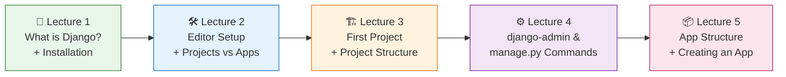

| # | Lecture | Topics Covered | Outcome |
|---|---------|---------------|---------|
| 1 | Introduction & Installation | What is Django, Why Django, MVT, Installing Python & Django | Working Django installation |
| 2 | Environment & Concepts | Editor setup (VS Code), venv, Projects vs Apps | Ready dev environment |
| 3 | First Project | `startproject`, project structure file-by-file, dev server | Running website on localhost |
| 4 | Command-line Tools | `django-admin` vs `manage.py`, all key commands | Command-line fluency |
| 5 | Apps | App structure file-by-file, creating & registering an app, first view | First working page |

---
---

# 📖 LECTURE 1 — Introduction to Django & Installation

### 🎯 Learning Objectives
By the end of this lecture, students will be able to:
1. Explain **what Django is** and where it is used
2. Describe the **MVT architecture**
3. **Install Python and Django** on their own machines
4. Verify the installation

---

## 1.1 What is Django? 🤔

**Django** is a **free, open-source, high-level web framework written in Python** that enables rapid development of secure and maintainable websites.

> 💬 **One-line definition for exams:**
> *"Django is a high-level Python web framework that encourages rapid development and clean, pragmatic design."* — Official Django tagline

### 🧩 What is a "Web Framework"?

Think of building a house 🏠:

| Without Framework | With Framework |
|---|---|
| Make your own bricks, cement, pipes | Bricks, cement & pipes are ready-made |
| Handle user login code from scratch | Login system built-in |
| Write SQL queries manually | Database handled by ORM |
| Worry about security attacks yourself | Security protections built-in |

A framework gives you the **skeleton + tools**; you focus only on **what makes your website unique**.

### 🌍 Who uses Django?

| Company | Use |
|---|---|
| 📷 **Instagram** | Entire backend |
| 🎵 **Spotify** | Backend services |
| 📌 **Pinterest** | Web platform |
| 🚀 **NASA** | Official website |
| 💬 **Disqus** | Comment system |

> 🗣️ **Fun fact:** Django is named after jazz guitarist **Django Reinhardt**. It's pronounced **"JANG-oh"** (the D is silent!).

---

## 1.2 Why Django? ✨ (Key Features)

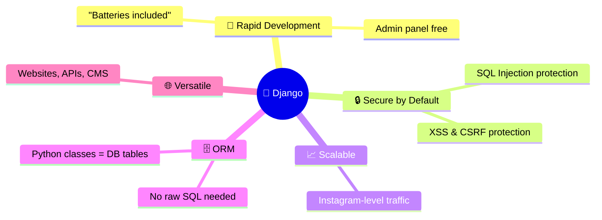

**The 5 features to remember (exam-friendly):**

1. **🔋 Batteries Included** — authentication, admin panel, forms, ORM all come pre-built
2. **🔒 Secure** — protects against SQL injection, XSS, CSRF out of the box
3. **📈 Scalable** — handles small blogs to Instagram-scale traffic
4. **⚡ Fast Development** — "The web framework for perfectionists with deadlines"
5. **🐍 Pythonic** — clean, readable code following DRY (*Don't Repeat Yourself*) principle

---

## 1.3 MVT Architecture 🏛️

Django follows **MVT = Model – View – Template** (a variant of the famous MVC pattern).

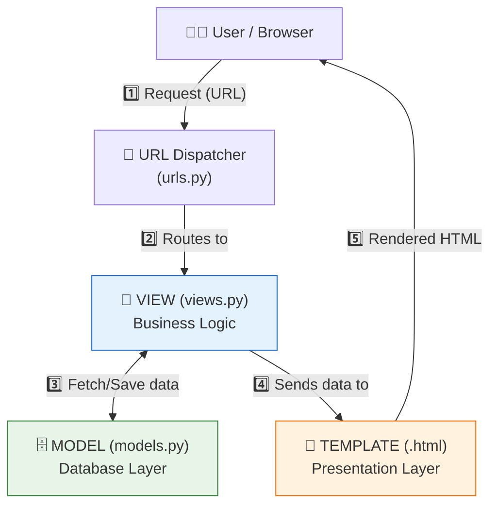

| Component | File | Responsibility | Analogy 🍽️ (Restaurant) |
|---|---|---|---|
| **Model** | `models.py` | Data & database structure | 🥬 Kitchen storage (ingredients) |
| **View** | `views.py` | Logic: what to do with a request | 👨‍🍳 Chef (prepares the dish) |
| **Template** | `.html` files | How the page looks | 🍽️ Plating & presentation |

> ⚠️ **Common confusion:** Django's **View** = MVC's **Controller**, and Django's **Template** = MVC's **View**. Interviewers love this question!

---

## 1.4 Installing Python 🐍

### Step 1 — Check if Python is already installed

```bash
python --version
# or on Mac/Linux:
python3 --version
```

✅ If you see `Python 3.10+` → skip to section 1.5
❌ If not → install:

### Step 2 — Install Python

| OS | Method |
|---|---|
| 🪟 **Windows** | Download from [python.org/downloads](https://python.org/downloads) → Run installer → ✅ **CHECK "Add Python to PATH"** (most common mistake if skipped!) |
| 🍎 **macOS** | `brew install python3` (or download from python.org) |
| 🐧 **Linux** | `sudo apt update && sudo apt install python3 python3-pip` |

### Step 3 — Verify pip (Python's package installer)

```bash
pip --version
# or
pip3 --version
```

> 📦 **What is pip?** *Pip Installs Packages* — it downloads Python libraries (like Django) from the internet (PyPI repository).

---

## 1.5 Installing Django 🎯

```bash
pip install django
```

That's it! ✨ Verify:

```bash
python -m django --version
# Output: 5.x.x  (your installed version)
```

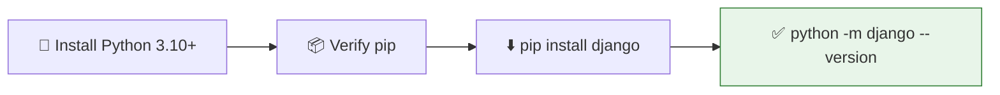

### 🛠️ Troubleshooting Corner

| Error | Fix |
|---|---|
| `'python' is not recognized` | Python not in PATH → reinstall with "Add to PATH" checked |
| `'pip' is not recognized` | Use `python -m pip install django` |
| Permission denied (Mac/Linux) | Use `pip install --user django` |

---

## ✅ CHECKPOINT — Lecture 1

**🧠 Quick Recap:**
- Django = high-level Python web framework, "batteries included"
- Follows **MVT**: Model (data) → View (logic) → Template (presentation)
- Install: `pip install django`, verify: `python -m django --version`

**❓ Quiz yourself:**
1. Django's View corresponds to which component of MVC? *(Controller)*
2. Name three security threats Django protects against by default.
3. What does the "D" in DRY stand for?

**🏠 Homework:** Install Python + Django on your laptop and bring a screenshot of `python -m django --version` output to the next class.

---
---

# 🛠️ LECTURE 2 — Editor Setup, Virtual Environments & Projects vs Apps

### 🎯 Learning Objectives
1. Set up **VS Code** for Django development
2. Create and use a **virtual environment**
3. Clearly distinguish a **Project** from an **App**

---

## 2.1 Setting Up the Editor (VS Code) 📝

**Why VS Code?** Free, lightweight, best Python/Django extension ecosystem.

### Step-by-step setup:

1. **Download** VS Code → [code.visualstudio.com](https://code.visualstudio.com)
2. **Install these extensions** (Ctrl+Shift+X):

| Extension | Why |
|---|---|
| 🐍 **Python** (Microsoft) | IntelliSense, debugging, linting |
| 🎨 **Django** (Baptiste Darthenay) | Django template syntax highlighting |
| ✨ **Pylance** | Fast, smart autocomplete |

3. **Open integrated terminal:** `` Ctrl + ` `` (backtick) — you'll run all Django commands here.

> 💡 **Pro tip:** `File → Open Folder` and open your *project folder* — VS Code works best folder-based, not file-based.

---

## 2.2 Virtual Environments 🧪 (Very Important!)

### The Problem 😰

Imagine two projects on one laptop:
- **Project A** needs Django 4.2
- **Project B** needs Django 5.0

Installing globally = 💥 conflict! Only one version can exist globally.

### The Solution ✅

A **virtual environment** = an **isolated Python box 📦 per project**, each with its own packages.

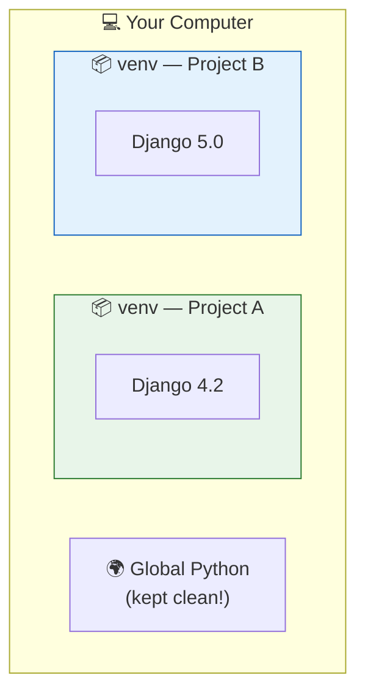

### Commands (memorize these!) 🧠

```bash
# 1️⃣ Create a virtual environment named "venv"
python -m venv venv

# 2️⃣ Activate it
venv\Scripts\activate        # 🪟 Windows
source venv/bin/activate     # 🍎🐧 Mac / Linux

# ✅ Your prompt changes to show (venv):
# (venv) C:\Users\you\myproject>

# 3️⃣ Install Django INSIDE the environment
pip install django

# 4️⃣ Deactivate when done
deactivate
```

> ⚠️ **Golden Rule:** *Always activate your venv before running any Django command.* If you see `ModuleNotFoundError: No module named 'django'` — 90% chance your venv is not activated!

---

## 2.3 Projects vs Apps 🏗️ (Core Concept!)

This is **the most important conceptual distinction** in Django.

> 🏢 **Analogy — A Shopping Mall:**
> - **Project** = The entire mall 🏬 (building, electricity, security, parking — shared infrastructure)
> - **Apps** = Individual shops inside 🛍️ (each does ONE thing: food court 🍔, cinema 🎬, clothing store 👕)

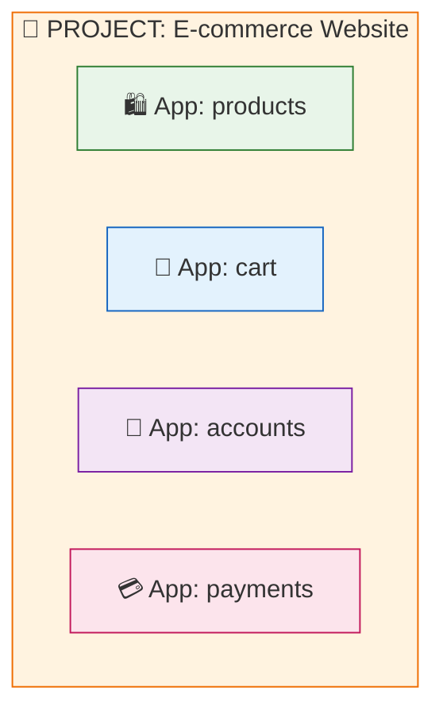

| | 🏬 Project | 🛍️ App |
|---|---|---|
| **What** | The whole website + configuration | One functional module |
| **Contains** | Settings, main URLs, deployment config | Models, views, templates for ONE feature |
| **Quantity** | ONE per website | MANY per project |
| **Command** | `django-admin startproject` | `python manage.py startapp` |
| **Reusable?** | ❌ No | ✅ Yes! An app can be plugged into other projects |
| **Example** | "AmazonClone" | "cart", "reviews", "orders" |

> 💬 **Exam-ready line:** *"A project is a collection of configuration and apps for a particular website. An app is a self-contained module that does one thing well and can be reused across projects."*

**✍️ Class Activity (5 min):** For a "University Portal" project, list 4 apps you would create. *(e.g., students, courses, results, library)*

---

## ✅ CHECKPOINT — Lecture 2

**🧠 Quick Recap:**
- VS Code + Python extension + integrated terminal = your Django workshop
- Virtual environment = isolated package box per project (`python -m venv venv` → activate)
- **1 Project : Many Apps**; apps are reusable, projects are not

**❓ Quiz yourself:**
1. What error usually appears when you forget to activate your venv?
2. Can one Django project have zero apps? Can an app exist without a project?
3. Give the activation command for venv on Windows vs Linux.

**🏠 Homework:** Create a folder `myfirstsite`, set up a venv inside it, activate it, and install Django in it.

---
---

# 🏗️ LECTURE 3 — Creating Your First Project & Project Structure

### 🎯 Learning Objectives
1. Create a Django project using `startproject`
2. Explain **every file** in the generated project
3. Run the **development server** and view the site

---

## 3.1 Creating Your First Project 🚀

With your venv **activated**:

```bash
django-admin startproject mysite
cd mysite
```

> 📌 **Naming rules:** letters, numbers, underscores only. No hyphens, no spaces. Avoid names like `django` or `test` (they clash with built-ins).

---

## 3.2 Project Structure — File by File 🗂️

```
mysite/                  ← 📁 Outer folder (just a container — rename freely)
│
├── manage.py            ← 🎮 Command-line utility (your remote control)
│
└── mysite/              ← 📁 Inner folder (the actual Python package — DON'T rename)
    ├── __init__.py      ← 🏷️ Marks this folder as a Python package
    ├── settings.py      ← ⚙️ All configuration (the brain 🧠)
    ├── urls.py          ← 🔀 URL routing table (the receptionist)
    ├── asgi.py          ← 🔌 Async server entry point (deployment)
    └── wsgi.py          ← 🔌 Sync server entry point (deployment)
```

> 😵 **"Why two folders with the same name?!"** — Every student asks this!
> The **outer** `mysite/` is just a container (you can rename it to anything).
> The **inner** `mysite/` is the real Python package that holds settings (renaming it breaks imports).

### 🔍 Deep-dive into each file:

#### 🎮 `manage.py`
Your project's **remote control**. You'll type `python manage.py <command>` hundreds of times. Never edit this file.

#### ⚙️ `settings.py` — the brain 🧠
The most-edited file. Key settings to know:

```python
# settings.py (important excerpts)

DEBUG = True            # 🐛 Show detailed errors (True in dev, MUST be False in production!)

ALLOWED_HOSTS = []      # 🌐 Domains allowed to serve this site

INSTALLED_APPS = [      # 📦 List of active apps (you'll add yours here!)
    'django.contrib.admin',
    'django.contrib.auth',
    'django.contrib.contenttypes',
    'django.contrib.sessions',
    'django.contrib.messages',
    'django.contrib.staticfiles',
]

DATABASES = {           # 🗄️ Database config (SQLite by default — zero setup!)
    'default': {
        'ENGINE': 'django.db.backends.sqlite3',
        'NAME': BASE_DIR / 'db.sqlite3',
    }
}

TIME_ZONE = 'UTC'       # 🕐 Change to 'Asia/Kolkata' for IST
```

#### 🔀 `urls.py` — the receptionist
Maps URLs → views. Like a receptionist directing visitors: *"Admin panel? Go to counter `/admin/`."*

```python
from django.contrib import admin
from django.urls import path

urlpatterns = [
    path('admin/', admin.site.urls),   # yoursite.com/admin/ → admin panel
]
```

#### 🔌 `wsgi.py` & `asgi.py`
Entry points for **production web servers** (WSGI = traditional/synchronous, ASGI = modern/async — supports WebSockets). You won't touch these until deployment.

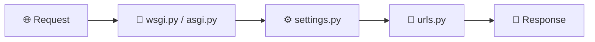

---

## 3.3 Running the Development Server ▶️

```bash
python manage.py runserver
```

Expected output:

```
Watching for file changes with StatReloader
Performing system checks...

System check identified no issues (0 silenced).

You have 18 unapplied migration(s). ...   ← ⚠️ Ignore for now (Lecture 4!)

Starting development server at http://127.0.0.1:8000/
Quit the server with CTRL-BREAK.
```

🌐 Open **http://127.0.0.1:8000/** in your browser → You'll see the 🚀 **rocket page**: *"The install worked successfully! Congratulations!"*

> 🎉 This moment = your first running Django website!

### Useful variations:

```bash
python manage.py runserver 9000          # 🔢 Different port
python manage.py runserver 0.0.0.0:8000  # 📱 Accessible from other devices on your Wi-Fi
```

### 🧠 Know-hows:
- **127.0.0.1** = `localhost` = "this same computer"
- **:8000** = port number (like a door number in a building)
- Server **auto-reloads** on every file save — no need to restart! 🔄
- Stop the server: `Ctrl + C`
- ⚠️ This server is for **development only** — never use it in production

---

## ✅ CHECKPOINT — Lecture 3

**🧠 Quick Recap:**
- `django-admin startproject mysite` → creates outer container + inner package
- `manage.py` = remote control | `settings.py` = brain | `urls.py` = receptionist | `wsgi/asgi.py` = deployment doors
- `python manage.py runserver` → 🚀 rocket page at `127.0.0.1:8000`

**❓ Quiz yourself:**
1. Which of the two `mysite` folders can be safely renamed?
2. Where would you add `'Asia/Kolkata'` and where would you register a new app?
3. What's the difference between WSGI and ASGI?

**🏠 Homework:** Create a project named `campusportal`, run the server on port **7000**, and screenshot the rocket page.

---
---

# ⚙️ LECTURE 4 — django-admin & manage.py Commands

### 🎯 Learning Objectives
1. Differentiate `django-admin` and `manage.py`
2. Use all essential day-to-day commands
3. Understand migrations at a basic level & create a superuser

---

## 4.1 django-admin vs manage.py 🥊

Both run the **same commands** — the difference is *context*:

| | 🌍 `django-admin` | 🎮 `python manage.py` |
|---|---|---|
| **What is it?** | Global command (installed with Django) | Script inside YOUR project |
| **Knows your settings?** | ❌ No | ✅ Yes (auto-points to your `settings.py`) |
| **Use it for** | Creating a project (before a project exists!) | Everything else afterwards |

> 💬 **Exam-ready line:** *"`manage.py` is a thin wrapper around `django-admin` that automatically sets the `DJANGO_SETTINGS_MODULE` environment variable to point to the current project's settings."*

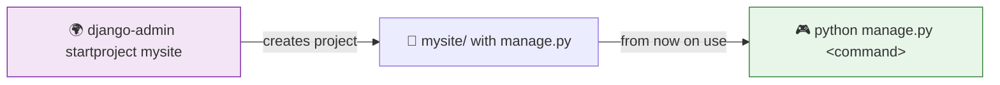

---

## 4.2 The Essential Commands Toolbox 🧰

### 📋 Master Table (keep this handy!)

| Command | Emoji | What it does |
|---|---|---|
| `startproject <name>` | 🏗️ | Creates a new project |
| `startapp <name>` | 📦 | Creates a new app |
| `runserver` | ▶️ | Starts the development server |
| `makemigrations` | 📝 | Writes DB change instructions from your models |
| `migrate` | 🗄️ | Applies those instructions to the database |
| `createsuperuser` | 👑 | Creates an admin account |
| `shell` | 🐚 | Opens interactive Python shell with Django loaded |
| `check` | ✅ | Checks project for problems (no DB touch) |
| `showmigrations` | 📜 | Lists migrations and their status ([X] = applied) |
| `collectstatic` | 🎨 | Gathers static files for deployment |
| `test` | 🧪 | Runs your test suite |
| `flush` | 🧹 | Empties database (⚠️ careful!) |
| `dbshell` | 💾 | Opens the database's own CLI |
| `--version` / `help` | ℹ️ | Version / list all commands |

---

## 4.3 Migrations — the 2-step dance 💃 (Intro)

**Migrations** = version control for your database structure.

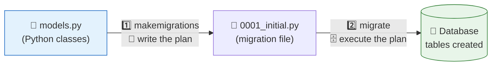

> 🍳 **Analogy:** `makemigrations` = writing the recipe 📝, `migrate` = actually cooking the dish 🍳.

Remember the warning `You have 18 unapplied migrations` from Lecture 3? Django's built-in apps (auth, admin, sessions) need database tables. Fix it:

```bash
python manage.py migrate
```

```
Operations to perform:
  Apply all migrations: admin, auth, contenttypes, sessions
Running migrations:
  Applying contenttypes.0001_initial... OK
  Applying auth.0001_initial... OK
  ...
```

✨ This creates `db.sqlite3` in your project folder — your database is born!

---

## 4.4 Creating a Superuser 👑

Django's **killer feature**: a free, full-featured admin panel!

```bash
python manage.py createsuperuser
```

```
Username: admin
Email address: admin@example.com
Password: ********        ← ⌨️ typing is invisible — that's normal!
Password (again): ********
Superuser created successfully. ✅
```

Now: `runserver` → visit **http://127.0.0.1:8000/admin/** → log in → 🎛️ full admin dashboard (Users & Groups manageable already — with ZERO code written!)

---

## 4.5 The Django Shell 🐚 (quick taste)

```bash
python manage.py shell
```

```python
>>> from django.contrib.auth.models import User
>>> User.objects.all()
<QuerySet [<User: admin>]>       # 👀 your superuser, queried with pure Python!
>>> exit()
```

> 💡 The shell is your **experiment lab** — test queries here before writing them in views.

---

## ✅ CHECKPOINT — Lecture 4

**🧠 Quick Recap:**
- `django-admin` = global (use once, to create project); `manage.py` = project-aware (use always after)
- The sacred workflow: `makemigrations` (write plan 📝) → `migrate` (apply plan 🗄️)
- `createsuperuser` → free admin panel at `/admin/` 👑

**❓ Quiz yourself:**
1. Why can't you use `manage.py` to create a brand-new project?
2. What is the difference between `makemigrations` and `migrate`?
3. Which command lists all migrations and shows which are applied?

**🏠 Homework:** In your `campusportal` project: run `migrate`, create a superuser, log into the admin panel, and add 2 new users through the admin UI.

---
---

# 📦 LECTURE 5 — App Structure & Creating Your First App

### 🎯 Learning Objectives
1. Create an app with `startapp`
2. Explain **every file** inside an app
3. **Register** the app in settings
4. Write your **first view** and map a URL to it → see your own page! 🎉

---

## 5.1 Creating an App 🛠️

Inside your project folder (venv active!):

```bash
python manage.py startapp blog
```

> 📛 **Naming convention:** apps are named after **what they do**, usually plural or functional: `blog`, `products`, `accounts`, `orders`.

---

## 5.2 App Structure — File by File 🗂️

```
blog/                        ← 📦 Your new app
├── __init__.py              ← 🏷️ Makes it a Python package
├── admin.py                 ← 🎛️ Register models to appear in admin panel
├── apps.py                  ← ⚙️ App configuration (name, settings)
├── models.py                ← 🗄️ M of MVT → database tables as Python classes
├── views.py                 ← 🧠 V of MVT → request-handling logic
├── tests.py                 ← 🧪 Your unit tests
└── migrations/              ← 📜 Folder storing DB change history
    └── __init__.py
```

### 🔍 Role of each file (mapped to MVT):

| File | MVT Role | One-liner |
|---|---|---|
| `models.py` | **M** 🗄️ | "What data do we store?" — DB tables as classes |
| `views.py` | **V** 🧠 | "What happens on a request?" — the logic |
| *(templates/)* | **T** 🎨 | "How does it look?" — you create this folder yourself |
| `admin.py` | — 🎛️ | "Show my models in the admin panel" |
| `apps.py` | — ⚙️ | "App's identity card" |
| `tests.py` | — 🧪 | "Prove the app works" |
| `migrations/` | — 📜 | "History of every DB change" |

> 🆚 **Notice:** an app has `models.py` & `views.py` but **no** `settings.py` (project-level) — while the project package has settings but no models. The structures perfectly mirror the Project-vs-App division of labour!

---

## 5.3 Registering the App ✍️ (Don't skip this!)

Django doesn't know your app exists until you **register** it.

Open `mysite/settings.py` → add your app to `INSTALLED_APPS`:

```python
INSTALLED_APPS = [
    'django.contrib.admin',
    'django.contrib.auth',
    'django.contrib.contenttypes',
    'django.contrib.sessions',
    'django.contrib.messages',
    'django.contrib.staticfiles',
    'blog',                    # 👈 YOUR APP — added here!
]
```

> ⚠️ **Top-3 beginner bug:** creating an app but forgetting to register it → models won't migrate, templates won't load. When something "mysteriously doesn't work," check `INSTALLED_APPS` first!

---

## 5.4 Your First View + URL 🎉 (The Payoff!)

Let's make the browser show **our own page** instead of the rocket.

### Step 1 — Write a view (`blog/views.py`):

```python
from django.http import HttpResponse

def home(request):
    return HttpResponse("<h1>🎉 Hello from the Blog app!</h1>")
```

*A view = a Python function that takes a `request` and returns a `response`. That's it!*

### Step 2 — Give the app its own URLs (create new file `blog/urls.py`):

```python
from django.urls import path
from . import views

urlpatterns = [
    path('', views.home, name='home'),   # '' = app's root URL
]
```

### Step 3 — Connect app URLs to the project (`mysite/urls.py`):

```python
from django.contrib import admin
from django.urls import path, include          # 👈 add include

urlpatterns = [
    path('admin/', admin.site.urls),
    path('', include('blog.urls')),            # 👈 hand over to blog app
]
```

### Step 4 — Run & marvel ✨

```bash
python manage.py runserver
```

Visit **http://127.0.0.1:8000/** → 🎉 **"Hello from the Blog app!"**

### 🔄 The full request journey you just built:

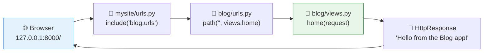

> 💡 **Why give each app its own `urls.py`?** Reusability! The `blog` app carries its URLs with it — plug it into any project with one `include()` line. (Mall analogy: each shop manages its own internal layout 🛍️.)

---

## 5.5 The Complete Picture 🖼️

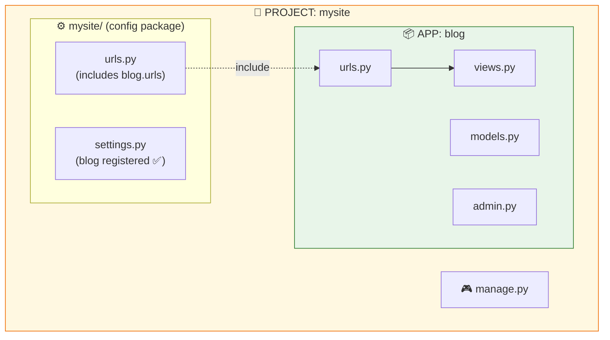

---

## ✅ CHECKPOINT — Lecture 5 (Unit Complete! 🏁)

**🧠 Quick Recap:**
- `python manage.py startapp blog` → app skeleton
- `models.py`=data, `views.py`=logic, `admin.py`=admin registration, `migrations/`=DB history
- **Register in `INSTALLED_APPS`** — the step everyone forgets!
- View function + app `urls.py` + project `include()` = your first custom page 🎉

**❓ Quiz yourself:**
1. Which file is present in a project package but NOT in an app? *(settings.py)*
2. What happens if you skip registering the app in `INSTALLED_APPS`?
3. Trace the journey of a request from browser to `HttpResponse` in 4 steps.

**🏠 Homework (mini-project):** In `campusportal`, create an app `students`, register it, and create two pages: `/` showing "Welcome to Campus Portal 🎓" and `/about/` showing your name and section.

---

## 🧾 Unit I — One-Page Revision Sheet

| Concept | Key Command / Fact |
|---|---|
| Install Django | `pip install django` |
| Virtual env | `python -m venv venv` → activate → then install |
| New project | `django-admin startproject mysite` |
| New app | `python manage.py startapp blog` |
| Run server | `python manage.py runserver` → 127.0.0.1:8000 |
| Apply DB changes | `makemigrations` → `migrate` |
| Admin account | `createsuperuser` → `/admin/` |
| Architecture | **MVT**: Model=data, View=logic, Template=look |
| Project vs App | 1 project = many apps; apps are reusable |
| #1 beginner bug | Forgetting app in `INSTALLED_APPS` ⚠️ |

> 🎓 **Next Unit Preview:** URLs in depth, Views (function & class-based), and Templates — making pages that actually look good! 🎨
